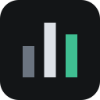
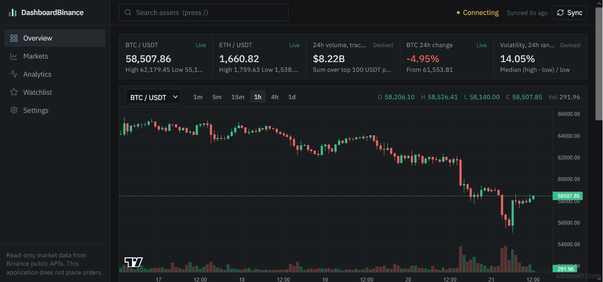
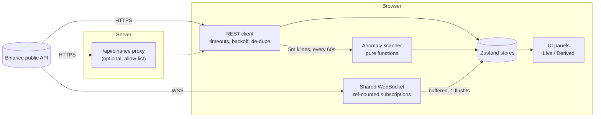

<div align="center">



# DashboardBinance

**A real-time crypto market terminal built on the public Binance API.**
Read-only. No API keys. No mock data.

[](https://binance-dashboard-mu.vercel.app)

[](https://nextjs.org/)
[](https://react.dev/)
[](https://www.typescriptlang.org/)
[](https://tailwindcss.com/)
[](https://zustand-demo.pmnd.rs/)


[Live demo](#live-demo) · [About](#about-this-project) · [Features](#features) · [Quick start](#quick-start) · [Data flow](#data-flow) · [Architecture](#architecture) · [Anomaly rules](#anomaly-rules) · [Limitations](#limitations)

<br />

<a href="https://binance-dashboard-mu.vercel.app">
  
</a>

</div>

---

## About this project

DashboardBinance is a **portfolio project** that shows how to build a live market-data application on top of a real public API, without a backend of its own and without API keys.

It connects to Binance market-data endpoints over REST and WebSocket, keeps prices streaming into the UI, renders candlestick charts, and runs a small statistical anomaly scanner on top of the raw data. The goal was not just a pretty dashboard, but a front end that stays correct and stable when the network does not: reconnects, rate limits, regional blocking and bursts of messages are all handled explicitly.

**It does not place orders and has no access to any account.**

## Live demo

**[binance-dashboard-mu.vercel.app](https://binance-dashboard-mu.vercel.app)**

> [!NOTE]
> The data is fetched live from Binance. Binance refuses access from some regions (HTTP 451), so the app may show an error state or fail to stream if your network or region is blocked. This is reported in the UI rather than hidden behind fake data.

## What this project demonstrates

| Skill | Where to look |
| --- | --- |
| Working with a real public API (REST + WebSocket) | [`lib/binance/rest.ts`](lib/binance/rest.ts), [`lib/binance/ws.ts`](lib/binance/ws.ts) |
| Resilient networking: timeouts, rate-limit backoff, request de-duplication, reconnect with exponential backoff and jitter | [`lib/binance/`](lib/binance) |
| High-frequency stream handling: one shared socket, ref-counted subscriptions, tick buffering with 1 flush per second | [`lib/binance/ws.ts`](lib/binance/ws.ts), [`store/market-store.ts`](store/market-store.ts) |
| Pure, testable domain logic with injected time and unit tests | [`lib/analytics/anomalies.ts`](lib/analytics/anomalies.ts), [`anomalies.test.ts`](lib/analytics/anomalies.test.ts) |
| Client state management | [`store/`](store) (Zustand, with a persisted watchlist) |
| Charting | [`components/chart/market-chart.tsx`](components/chart/market-chart.tsx) (TradingView Lightweight Charts) |
| Secure server proxy with an allow-list | [`app/api/binance/[...path]/route.ts`](app/api/binance/%5B...path%5D/route.ts) |
| Honest UI: loading, error and retry states; `Live` vs `Derived` labels | `components/` |

## Features

- **Live market table.** Top 100 USDT pairs by 24h volume, prices pushed over WebSocket and flushed to the UI once per second.
- **Interactive charts.** Candlesticks with volume, intervals from 1m to 1d, live updates and automatic re-sync after a reconnect.
- **Asset detail.** Candles, live trades feed and order book for any tracked pair.
- **Anomaly scanner.** Four transparent statistical rules (volume spike, momentum, volatility, MA deviation) on the 20 most liquid pairs, rescanned every 60 seconds.
- **Market breadth.** Advancing, flat and declining counts, plus top gainers and losers over 24h.
- **Watchlist.** Starred assets are stored in your browser (`localStorage`); nothing is sent to a server.
- **Connection diagnostics.** The header and Settings page show WebSocket state, reconnect count and snapshot age.
- **Live vs Derived labels.** Every panel says whether its values come straight from Binance or are calculated in the app.

## Anomaly scanner

<p align="center">
  
</p>

The scanner evaluates only the latest **closed** 5-minute candle, never the one still forming. See [Anomaly rules](#anomaly-rules) for thresholds.

## Quick start

```bash
git clone https://github.com/YOUR_USERNAME/dashboardbinance.git
cd dashboardbinance
npm install
npm run dev
```

Open [http://localhost:3000](http://localhost:3000).

| Command | What it does |
| --- | --- |
| `npm run dev` | Start the dev server |
| `npm run build` | Production build |
| `npm start` | Serve the production build |
| `npm run typecheck` | TypeScript check (`tsc --noEmit`) |
| `npm run lint` | ESLint |
| `npm test` | Unit tests for the anomaly rules |

### Configuration

Everything is optional. Defaults point to the public, keyless Binance market-data endpoints.

```bash
cp .env.example .env.local
```

| Variable | Default | Purpose |
| --- | --- | --- |
| `NEXT_PUBLIC_BINANCE_REST_URL` | `https://data-api.binance.vision` | REST base URL |
| `NEXT_PUBLIC_BINANCE_WS_URL` | `wss://stream.binance.com:9443/ws` | WebSocket URL |
| `BINANCE_UPSTREAM_URL` | `https://data-api.binance.vision` | Upstream used by the built-in proxy |

> [!TIP]
> If the browser cannot reach Binance directly (CORS or regional blocking), set
> `NEXT_PUBLIC_BINANCE_REST_URL=/api/binance` to route REST calls through the built-in allow-listed proxy.

## Data flow



<details>
<summary><b>Endpoints and cadence</b></summary>

| Need | Source | Cadence |
| --- | --- | --- |
| Tracked universe and 24h stats | `GET /api/v3/ticker/24hr` (weight 80) | Once at load, plus manual Sync (min 10s apart) |
| Live prices | WebSocket `<symbol>@miniTicker` for the top 100 USDT pairs | Pushed, flushed to the UI once per second |
| Candles | `GET /api/v3/klines`, then `<symbol>@kline_<interval>` | On symbol/interval change, re-fetched after a WS reconnect |
| Recent trades | `GET /api/v3/trades`, then `<symbol>@trade` | Live, batched every 400ms, de-duplicated by trade id |
| Order book | `GET /api/v3/depth` | Every 5s while the tab is visible |
| Anomaly scan | `GET /api/v3/klines` (5m, 120 candles) for the 20 most liquid pairs | Every 60s while visible (about 40 request weight) |
| Single price | `fetchLastPrice` wraps `GET /api/v3/ticker/price` | Available in `lib/binance/rest.ts`; not used by the UI because the WS feed already carries prices |

</details>

**Live vs Derived.** Panels tagged `Live` show values straight from Binance. Panels tagged `Derived` are calculated here: tracked volume, median 24h range, breadth, spread, range position and anomaly flags.

## Architecture

```text
app/                    routes: Overview, Markets, Analytics, Watchlist, Settings, asset/[symbol], api/binance proxy
components/
  layout/               shell, sidebar, header, search, connection status
  market/               metric strip, asset table, breadth
  chart/                Lightweight Charts wrapper
  asset/                asset detail, trades, order book
  analytics/            anomaly panel, rules panel
  ui/                   button, input, skeleton, panel
lib/binance/            REST client, WebSocket client, types
lib/analytics/          indicator math, anomaly rules, scanner, tests
store/                  Zustand: market, anomalies, watchlist (persisted)
hooks/                  polling, ticker, scan lifecycle
```

### Key decisions

- **One shared WebSocket** with reference-counted subscriptions, batched SUBSCRIBE/UNSUBSCRIBE (Binance allows 5 control messages per second), a stall watchdog and an idle close after the last consumer leaves.
- **Tick buffering.** Messages go into a buffer that is flushed once per second, so render rate is independent of message rate.
- **Rules as a single source of truth.** The anomaly rules live in one `RULES` object. The detector and the "Detection rules" panel both read it, so documentation cannot drift from behaviour.
- **Pure, testable detection.** `now` is injected, and the rules are unit-tested.
- **Closed candles only.** The still-forming candle is never evaluated.
- **No fallback data.** If a request fails, the UI shows an error with a retry. It never substitutes mock values.

## Anomaly rules

Evaluated on 5-minute candles.

| Rule | Measure | Low / Medium / High |
| --- | --- | --- |
| Volume spike | Last candle quote volume / mean of previous 20 | 3x / 5x / 8x |
| Momentum | Absolute change over 12 candles (60 min) | 2% / 3.5% / 5% |
| Volatility | Stdev of 12 recent log returns / stdev of the 96 before | 2x / 3x / 4x |
| MA deviation | Distance of close from SMA20 | 1.5% / 2.5% / 4% |

**Guards:** volume spikes are ignored when the baseline averages under $5,000 per candle; volatility is ignored when recent stdev is under 0.05% per candle. Detections are kept for one hour.

> [!WARNING]
> These are statistical flags, not trading signals. This project is not financial advice.

## Limitations

- The tracked universe is the top 100 USDT pairs by 24h volume at the time of the snapshot, not every Binance market.
- 24h change is computed from the stream's 24h open and the last price, so it can differ slightly from the REST field.
- Binance may refuse access from some regions (HTTP 451). The app reports this instead of falling back to anything.
- Watchlist persistence is per browser (`localStorage`).

## Tech stack

Next.js (App Router) · React 19 · TypeScript · Tailwind CSS · shadcn/ui-style primitives · TradingView Lightweight Charts v4 · Zustand · Lucide icons · Deployed on Vercel

## Author

**YOUR_NAME**: [GitHub](https://github.com/YOUR_USERNAME) · [LinkedIn](https://linkedin.com/in/YOUR_PROFILE) · [Email](mailto:YOUR_EMAIL)

## Disclaimer

This project is not affiliated with or endorsed by Binance. It uses only public market-data endpoints and cannot place orders.

## License

MIT © YOUR_NAME (add a `LICENSE` file to the repository).
